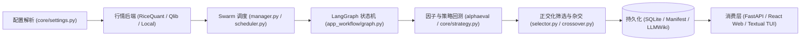
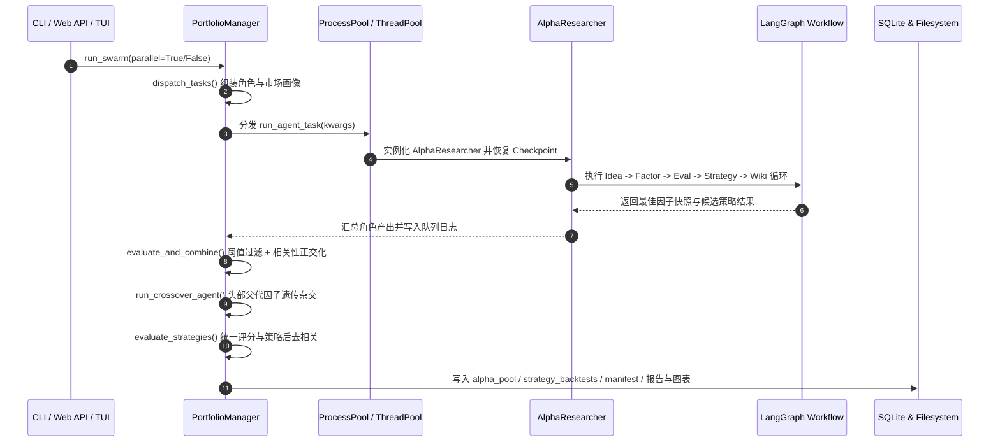
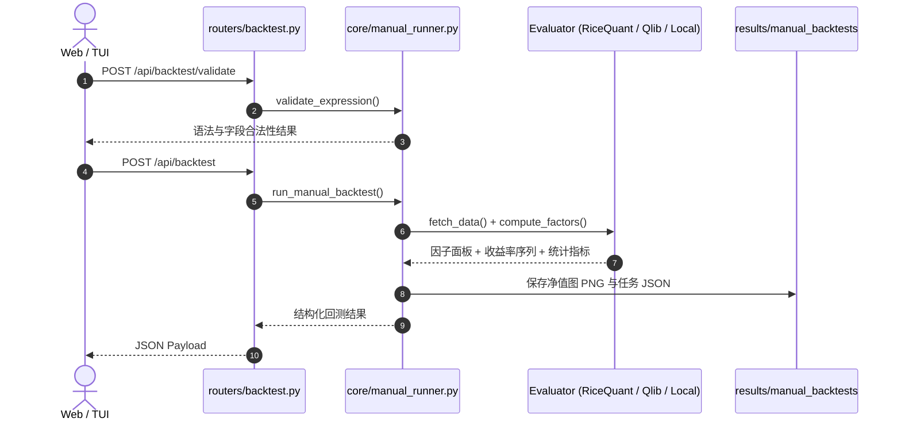
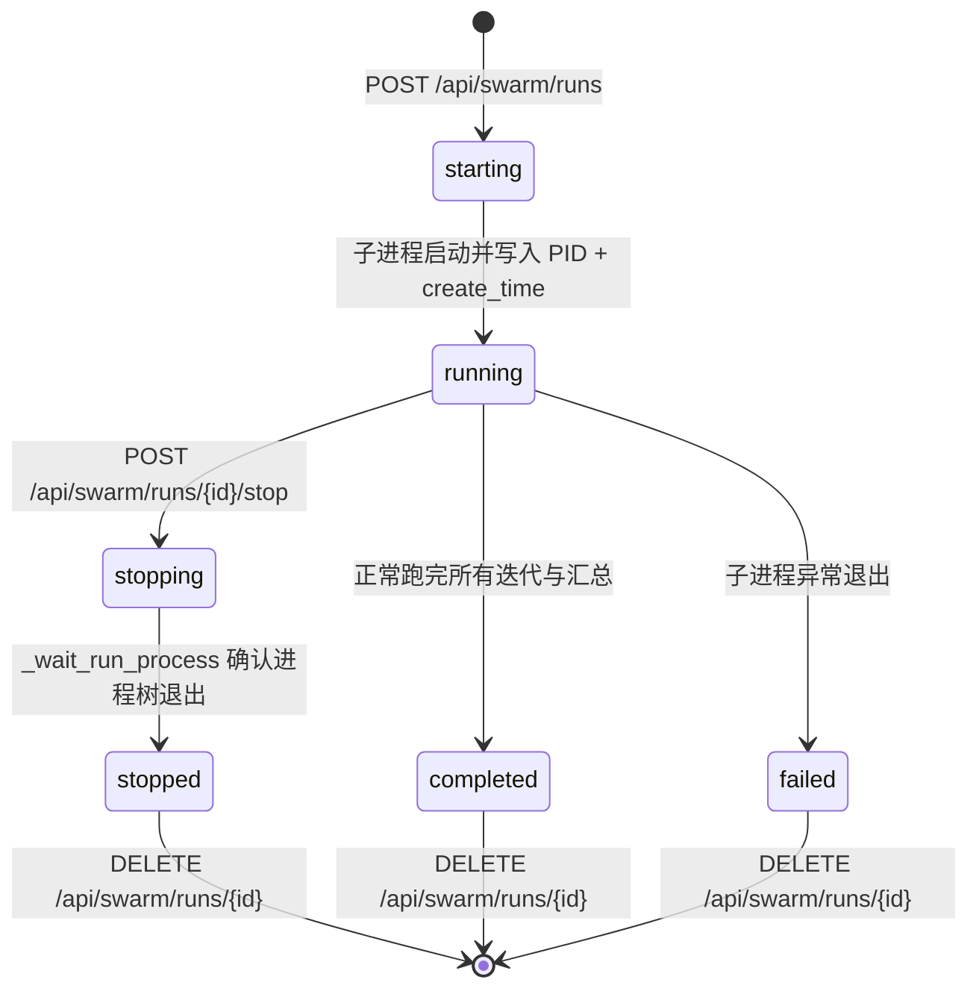

# AI Alpha Miner 架构与实现技术参考

本文档面向仓库维护者与二次开发者，提供与当前源码（`src/aiminer/`、`polars_plugins/`、`frontend/`）严格对应的架构设计、数据流、核心模块职责、数据库与接口契约说明。

---

## 1. 系统总体架构

AI Alpha Miner 将多智能体量化因子挖掘、横截面/时序策略回测、研究知识沉淀与可视化工作台整合在同一套代码库中。Python 核心包位于 `src/aiminer/`，通过 `pyproject.toml` 暴露五个命令行入口：`aiminer-manager`、`aiminer`、`aiminer-api`、`aiminer-tui` 与 `aiminer-futures-strategy`。



### 1.1 目录结构总览

| 目录 / 文件 | 职责说明 |
|---|---|
| `src/aiminer/manager.py` | Swarm 顶层协调器 `PortfolioManager` 与 `aiminer-manager` CLI 入口 |
| `src/aiminer/scheduler.py` | 进程池/线程池执行器封装、并发度控制、全局超时与子进程日志转发 |
| `src/aiminer/selector.py` | 候选因子评分、模拟结果过滤、负 IC 信号翻转与收益率相关性去重 |
| `src/aiminer/crossover.py` | 头部父代因子的遗传杂交（Crossover）角色构造与结果验收 |
| `src/aiminer/persistence.py` | SQLite（`alpha_miner.db`）建表、列迁移、JSON 镜像原子写入与检查点恢复 |
| `src/aiminer/sub_agent.py` | 单个研究员 `AlphaResearcher` 的生命周期封装 |
| `src/aiminer/main.py` | 单智能体工作流调试入口（`aiminer`） |
| `src/aiminer/api.py` | FastAPI 应用组装、CORS 与静态资源挂载、向后兼容符号导出 |
| `src/aiminer/routers/` | 模块化 HTTP 与 WebSocket 路由（`common`、`swarm`、`backtest`、`strategy`、`wiki`、`admin`、`websocket`） |
| `src/aiminer/tui.py` | 基于 Textual 的终端交互式工作台（`aiminer-tui`） |
| `src/aiminer/futures_strategy.py` | 股指期货多品种面板合成与策略执行入口（`aiminer-futures-strategy`） |
| `src/aiminer/app_workflow/` | LangGraph 状态定义（`state.py`）与条件路由图（`graph.py`） |
| `src/aiminer/agents/` | 各阶段智能体实现（`idea`、`factor`、`eval`、`strategy`、`strategy_critic`、`portfolio`、`summary`） |
| `src/aiminer/core/` | 配置、LLM 网关、本地 Codex 包装、RAG/Wiki 混合知识库、因子求值引擎、策略回测、因子生命周期与运行清单 |
| `src/aiminer/schemas/` | LLM 结构化输出 Pydantic 模型（`messages.py`） |
| `polars_plugins/` | 基于 Rust + PyO3/Maturin 编写的 Polars 原生时序与截面算子插件 |
| `frontend/` | React 18 + TypeScript + Vite + TanStack Query Web 工作台 |
| `scripts/` | 行情下载、文献抓取、工作区重置、夜间自动化值守与 CI 校验脚本 |
| `tests/` | 单元测试（`tests/unit/`）、集成测试（`tests/integration/`）与浏览器端到端测试 |

---

## 2. 核心执行链路与数据流

### 2.1 多智能体 Swarm 主链路



在单次 `AlphaResearcher` 运行内部，LangGraph 状态机（`src/aiminer/app_workflow/graph.py`）维护共享状态字典 `AlphaMinerState`，按以下规则推进：

1. **`idea_node`（`IdeaAgent`）**：从 `HybridKnowledge` 召回与当前角色和市场相关的文献片段及历史 Wiki 卡片，输出结构化研究假说（`HypothesisOutput`）。
2. **`factor_node`（`FactorAgent`）**：将假说转换为公式与算子表达式，执行字段与算子白名单校验。若语法非法，记录错误并路由回下一轮迭代。
3. **`eval_node`（`EvalAgent`）**：调用底层评估器计算因子值与分层收益，生成 IC、Rank IC、ICIR、夏普比率等指标，并由 LLM 给出有效性评审（`ReflexiveReviewOutput`）。若底层回测抛出异常，评估器生成的哈希模拟指标会被标记为 `is_simulated=True`，供后续环节严格剔除。
4. **`route_after_eval` 条件分支**：
   - 若因子有效（`is_effective=True` 且非模拟数据），进入策略衍生节点（`strategy_node` → `strategy_eval_node` → 可选 `strategy_critic_node`），随后进入 `wiki_update_node` 将有效因子写入 `LLMWiki`。
   - 若因子无效，跳过策略与 Wiki 节点，直接进入 `increment_iteration`。
5. **提前收敛判定（Early Stopping）**：除非显式传入 `--disable-early-stop`，当单轮因子 `|IC| >= 0.05` 或连续未刷新最优 IC 的轮数达到 `patience >= 3` 时，状态机提前结束当前研究员循环，返回历史最优快照 `best_factor_snapshot`。

---

### 2.2 手工因子回测链路

Web 前端（`/manual`）或 TUI 提交单个表达式时，调用链不经过 LLM，直接由 `src/aiminer/core/manual_runner.py` 驱动评估器：



---

### 2.3 策略回测与评分链路

策略层（`src/aiminer/core/strategy.py`）负责将因子的二维信号面板转化为受约束的持仓权重矩阵并核算交易后净值。

#### 2.3.1 信号面板到持仓矩阵

评估器计算出的因子序列与前瞻收益标签首先展开为以交易日为行（`index=date`）、标的为列（`columns=instrument`）的二维面板 `signal_df` 与 `label_df`。若因子在筛选阶段因负 IC 被标记了 `signal_multiplier = -1`，回测前先对 `signal_df` 整体反号。

随后 `StrategyBacktester` 按 `StrategyConfig` 生成原始目标仓位：

- **横截面模式（`cross_sectional`）**：按交易日逐行排序或阈值过滤，支持 `top_n`、`bottom_n`、`top_bottom_n` 与 `threshold` 四种选股规则，以及 `long_only` 和 `long_short` 两种方向。
- **时序模式（`time_series`）**：按标的逐列考察时间序列，仅支持 `threshold` 规则，配合 `long_threshold`、`short_threshold` 与 `exit_threshold` 实现 `long_flat`（多头/空仓）或 `long_short`（多空切换）。

生成原始信号仓位后，依次施加四项交易约束：

1. **调仓掩码（`_rebalance_mask`）**：按 `daily`、`weekly` 或 `monthly` 决定允许调仓的交易日，非调仓日沿用上一交易日持仓。
2. **持仓数量上限（`max_positions`）**：截断超出数量限制的弱信号持仓。
3. **最短持有期（`min_holding_days`）**：未满最短持有天数的现有持仓保持方向不变，抑制高频信号闪烁带来的无效换手。
4. **敞口归一化与单票上限（`_normalize_positions`）**：按总敞口（Gross Exposure）归一化权重，并将单标的绝对权重裁剪至 `max_weight_per_position` 以内。

#### 2.3.2 净值、成本与综合评分

每日毛收益、换手率与扣除双边成本后的净收益按以下公式计算：

$$\text{gross\_return}_t = \sum_i w_{t,i} \cdot r_{t,i}$$

$$\text{turnover}_t = \sum_i |w_{t,i} - w_{t-1,i}|$$

$$\text{cost}_t = \text{turnover}_t \times \frac{\text{commission\_bps} + \text{slippage\_bps}}{10000}$$

$$\text{net\_return}_t = \text{gross\_return}_t - \text{cost}_t$$

在 Swarm 自动策略评选中，`selection_score()` 综合考量收益、风险与换手成本：

$$\text{score} = 0.35 \cdot \text{AnnReturn} + 0.35 \cdot \text{Sharpe} + 0.15 \cdot |\text{IC}| - 0.08 \cdot |\text{MaxDrawdown}| - 0.04 \cdot \text{Turnover} - 0.03 \cdot \text{CostDrag}$$

若启用了多窗口滚动验证（Walk-Forward，窗口数 $\ge 2$），评分函数会降低全样本 Sharpe 权重，并额外引入最差窗口夏普（`min_sharpe`）、正收益窗口占比（`consistency`）与跨窗口夏普标准差惩罚（`sharpe_std`），抑制单一牛熊区间过拟合。

---

## 3. 核心子系统实现细节

### 3.1 顶层调度与因子筛选（`manager.py` / `scheduler.py` / `selector.py` / `crossover.py`）

原先集中在单文件中的调度逻辑已按职责拆分为五个协作模块：

- **`src/aiminer/manager.py`（`PortfolioManager`）**：协调任务分发（`dispatch_tasks`）、结果合并（`evaluate_and_combine`）、策略评估（`evaluate_strategies`）与多因子组合权重计算。
- **`src/aiminer/scheduler.py`**：管理并发工作池。默认使用 `ProcessPoolExecutor`（`spawn` 启动方式）；当运行环境使用本地 GPU Embedding 或跨进程不安全的原生库时，可通过 `--swarm-executor thread` 或环境变量自动降级为线程池，并通过 `_WORKER_LOG_QUEUE` 将子进程日志统一回传至主进程。
- **`src/aiminer/selector.py`**：执行因子入池筛选。首先过滤 `is_simulated=True` 与 `|IC| < IC_CULL_THRESHOLD`（默认 `0.01`）的因子；对 `IC < 0` 的有效因子翻转其收益序列与信号乘子；最后按候选因子综合得分从高到低遍历，计算日收益序列皮尔逊相关系数（或通过 `core/orthogonalization.py` 计算截面正交相关性与增量 IC），剔除与已入池因子相关性超过阈值（默认 `0.7`）的冗余因子。
- **`src/aiminer/crossover.py`**：当正交化后的因子池中存在至少两个有效父代因子时，构造 `CROSSOVER_ROLE` 提示词，提取父代因子的表达式与优势特征，启动专门的 `AlphaResearcher` 进行遗传杂交，若杂交子代因子通过回测且与父代保持足够差异化，则一并纳入因子池。
- **`src/aiminer/persistence.py`**：封装 SQLite WAL 模式初始化、表结构自愈迁移（`ALTER TABLE` 补齐缺失列）、`alpha_pool.json` 临时文件原子替换（`_atomic_write_json`），以及基于 `agent_checkpoints` 表的断点恢复（`recover_checkpoint_results`）。

### 3.2 算子求值引擎与 AST 安全边界（`core/alphaeval/` & `polars_plugins/`）

表达式求值支持两套计算引擎，均在受控 AST 下运行：

1. **Pandas 引擎与安全变换器（`src/aiminer/core/alphaeval/rq_eval.py`）**：
   - `SafeEvalTransformer` 遍历 Python AST，仅允许调用预注册的算子函数与基础算术/比较运算，将未绑定标识符受控转换为字符串列名或拦截报错，杜绝属性穿透（如 `__class__`、`__subclasses__`）与任意代码执行。
   - `RiceQuantEval` 负责行情拉取、横截面每日 Spearman Rank IC 计算、五分位分层净值统计（`calculate_layered_returns`）以及噪声注入稳健性检验（`run_robustness_test`）。

2. **Polars 引擎与 Rust 原生插件（`src/aiminer/core/alphaeval/polars_engine.py` & `polars_plugins/`）**：
   - `PolarsEngine` 通过 `_eval_ast_node` 直接将表达式 AST 解释为 Polars 列表达式（`pl.Expr`），利用 Polars 多线程向量化引擎批量求值。
   - 内置支持的算子涵盖：
     - **截面算子**：`Rank`、`CSRank`、`CSZScore`、`Scale`、`Winsorize`、`GroupNeutral`、`Percentile`
     - **时序位移与差分**：`Ref`、`Delta`
     - **时序滚窗统计**：`Mean`、`Std`、`Var`、`Median`、`Sum`、`Skew`、`Kurt`、`Mad`、`Corr`、`Cov`、`WMA`、`EMA`、`Count`
     - **时序极值与分位**：`Ts_Rank`、`Ts_Max`、`Ts_Min`、`Ts_ArgMax`、`Ts_ArgMin`、`Ts_Percentile`
     - **逐元素数学与条件运算**：`Abs`、`Log`、`Sign`、`Sqrt`、`Exp`、`Ceil`、`Floor`、`Round`、`Sin`、`Cos`、`Tan`、`Clip`、`If`、`And`、`Or`、`Not`、`Greater`、`Less`、`Equal` 等
   - 当 `polars_plugins` 编译安装就绪时，`Ts_Rank`、`Ts_ArgMax`、`Ts_ArgMin` 等高频窗口运算会自动挂载 Rust 动态库执行，显著降低长周期面板的计算耗时。

### 3.3 因子生命周期与运行清单（`core/lifecycle.py` & `core/manifest.py`）

- **生命周期管理（`src/aiminer/core/lifecycle.py`）**：跟踪入库因子在后续回测评估中的表现变化。当因子在连续评估中出现显著衰减时递增 `decay_streak` 并在达到阈值后标记为退役（Retired）；若因子在新一期评估中恢复有效表现，则自动重置 `decay_streak`。
- **可复现运行清单（`src/aiminer/core/manifest.py`）**：为每次 Swarm 运行生成包含代码版本、模型配置、市场画像、时间区间、标的池（Universe）元数据与结果计数的结构化 Manifest，落盘至 `results/swarm_runs/<run_id>.json`。

### 3.4 混合知识库（`core/rag.py` / `core/wiki.py` / `core/hybrid_knowledge.py`）

`HybridKnowledge` 将静态语料检索与动态经验沉淀结合为统一接口：

- **`RAGModule`（`core/rag.py`）**：管理 `data/rag_docs/` 下的文献、WorldQuant 101 公式与宏观新闻，切片后写入 ChromaDB（`data/chroma_db/`）。多进程并发访问通过 `core/chroma_lock.py` 文件锁协调，避免 SQLite/DuckDB 索引损坏。
- **`LLMWiki`（`core/wiki.py`）**：管理 `data/wiki_vault/` 下的 Markdown 知识卡片。每张卡片包含 YAML Frontmatter（`title`、`type`、`status`、`tags`、`related`、`updated_at`）与正文中的 `[[wikilink]]`。每次写入或迁移后，系统自动执行反向链接审计（`_backlink_audit`）并重编译 `index.md`。

---

## 4. HTTP API 与 WebSocket 服务架构

服务端采用 FastAPI 构建，入口为 `src/aiminer/api.py`，具体业务逻辑按领域拆分在 `src/aiminer/routers/` 下：

| 路由模块 | 主要接口路径 | 功能说明 |
|---|---|---|
| `routers/common.py` | - | 全局状态 `GlobalState`、鉴权依赖 `_require_actor`、SQLite 连接、Swarm 子进程监控与 Manifest 读写工具 |
| `routers/swarm.py` | `/api/swarm/status`<br>`/api/swarm/runs`<br>`/api/swarm/runs/{run_id}`<br>`/api/swarm/runs/{run_id}/logs`<br>`/api/swarm/runs/{run_id}/stop` | 查询并发运行状态、分页列出历史 Run、启动新 Swarm 子进程、分页读取 JSONL 事件流、执行两阶段停止（`stopping` → `stopped`）及删除已终止 Run |
| `routers/backtest.py` | `/api/results`<br>`/api/factors/{factor_id}`<br>`/api/charts/{filename}`<br>`/api/reports/{filename}`<br>`/api/backtest/validate`<br>`/api/backtest`<br>`/api/backtest/history`<br>`/api/factors/crossover` | 因子池分页查询、单因子详情与图表/报告读取、手工表达式校验与回测、手工历史管理、触发因子杂交 |
| `routers/strategy.py` | `/api/strategy/run`<br>`/api/strategy/history`<br>`/api/strategies`<br>`/api/strategies/{strategy_id}`<br>`/api/strategy/charts/{filename}` | 执行手工策略回测、查询策略历史与策略池分页列表、获取单策略持仓与净值详情、读取策略图表 |
| `routers/wiki.py` | `/api/wiki/index`<br>`/api/wiki/page/{slug}`<br>`/api/wiki/graph`<br>`/api/wiki/lint`<br>`/api/wiki/migrate` | 分页获取 Wiki 索引、读写单页 Markdown、生成节点与边关系图数据、执行格式校验与旧卡片迁移 |
| `routers/admin.py` | `/api/health`<br>`/api/readiness`<br>`/api/admin/reset`<br>`/` (SPA Fallback) | 存活与就绪探针、工作区可逆重置接口、前端静态资源托管与 SPA 路由兜底 |
| `routers/websocket.py` | `/ws` | 实时广播 Swarm 运行事件流，支持 Query Token 鉴权与心跳保活 |

### 4.1 进程存活校验与两阶段停止状态机

由于 API 进程可能重启，Swarm 运行状态不能仅依赖内存字典。`routers/common.py` 将内存中的 `RunState` 与磁盘上的 `results/swarm_runs/<run_id>.json` 结合，并通过 `psutil` 核对 `process_pid` 与 `process_create_time`（防止操作系统 PID 复用导致误判）：



当用户调用停止接口时，若目标进程仍在运行，接口立即将 Manifest 状态更新为 `stopping` 并向进程树发送终止信号，待后台监控线程确认子进程彻底退出后再写入 `stopped`。删除接口同样会先核验进程存活态，拒绝删除仍在运行或处于 `stopping` 中的任务记录。

---

## 5. 数据库表结构与接口契约

SQLite 主数据库位于 `results/alpha_miner.db`（开启 `PRAGMA journal_mode=WAL`），核心表结构如下：

### 5.1 `alpha_pool`（有效因子表）

| 字段名 | 类型 | 说明 |
|---|---|---|
| `factor_id` | `TEXT PRIMARY KEY` | 因子唯一标识 |
| `run_id` | `TEXT` | 产出该因子的 Swarm Run ID |
| `role` | `TEXT` | 产出该因子的研究员角色名称 |
| `hypothesis` | `TEXT` | 研究假说描述 |
| `code` | `TEXT` | 算子表达式 |
| `ic_mean` / `rank_ic` / `sharpe` | `REAL` | 核心回测指标 |
| `perf_metric` | `REAL` | 综合排序指标 |
| `is_effective` | `INTEGER` | 是否通过有效性筛选（`1` 或 `0`） |
| `metrics_json` | `TEXT` | 完整评估指标 JSON |
| `returns_json` | `TEXT` | `{date: float}` 格式的每日收益率序列 |
| `report_path` / `chart_path` | `TEXT` | 关联的 Markdown 报告与净值图路径 |
| `lifecycle_state` / `decay_streak` | `TEXT` / `INTEGER` | 因子生命周期状态与连续衰减计数 |
| `created_at` | `TEXT` | 入库时间戳 |

### 5.2 `strategy_backtests`（策略回测表）

| 字段名 | 类型 | 说明 |
|---|---|---|
| `strategy_id` | `TEXT PRIMARY KEY` | 策略回测唯一标识 |
| `cache_key` | `TEXT` | 基于表达式、策略配置、市场与信号乘子计算的哈希键 |
| `run_id` / `source_factor_id` / `agent_id` | `TEXT` | 来源 Swarm Run、关联因子 ID 与研究员 ID |
| `template_name` / `candidate_rank` | `TEXT` / `INTEGER` | 策略模板名称与候选序号 |
| `rationale` | `TEXT` | 策略设计理由或 Critic 修正说明 |
| `selection_score` | `REAL` | 综合评选得分 |
| `is_primary` | `INTEGER` | 是否为关联因子的最优主策略 |
| `expression` | `TEXT` | 因子表达式 |
| `strategy_config_json` | `TEXT` | `StrategyConfig` 完整 JSON |
| `metrics_json` | `TEXT` | 年化收益、夏普、最大回撤、换手率、成本拖累等指标 |
| `daily_returns_json` | `TEXT` | 每日策略净收益率序列 |
| `positions_json` / `trade_stats_json` | `TEXT` | 最新持仓快照与交易统计 |
| `chart_paths_json` | `TEXT` | 净值曲线与换手率曲线图路径 |
| `created_at` | `TEXT` | 记录创建时间 |

### 5.3 `agent_checkpoints`（断点恢复表）

保存每个 `(run_id, agent_id)` 在迭代过程中的最新轮次、最优因子快照与中间状态 JSON，供 `hermes_auto_runner.py` 或指定 `--run-id` 的任务在中断后恢复执行。

### 5.4 分页接口通用契约

所有列表类 HTTP 接口（`/api/results`、`/api/strategies`、`/api/swarm/runs`、`/api/swarm/runs/{run_id}/logs`、`/api/wiki/index`）统一返回如下分页结构（对应前端 `Paginated<T>`）：

```json
{
  "items": [],
  "total": 42,
  "offset": 0,
  "limit": 50
}
```

---

## 6. Web 前端实现说明（`frontend/`）

前端基于 React 18、TypeScript 5、Vite 5、React Router 6 与 TanStack Query 5 构建，不承担因子或回测计算，专注于配置编排、实时事件流消费与结果可视化：

- **API 客户端（`frontend/src/lib/api.ts`）**：统一封装 `fetch`，从 `localStorage` 读取 Token 并自动注入 `Authorization: Bearer` 与 `X-API-Key` 请求头；根据响应 `Content-Type` 自动解析 JSON 或纯文本（用于 Wiki Markdown）。
- **实时事件流（`frontend/src/lib/ws.ts`）**：`useSocketFeed()` Hook 建立 `/ws` 连接，内置 15 秒心跳保活与指数退避重连（1s 至 10s），维护最近 500 条实时事件供运行详情页合并去重展示。
- **核心页面（`frontend/src/pages/`）**：
  - `SwarmRunsPage.tsx`：Swarm 参数表单、并发配额展示、历史运行列表与两阶段停止状态反馈。
  - `SwarmRunDetailPage.tsx`：合并历史 JSONL 日志与 WebSocket 实时事件，展示单次运行的因子与策略产出。
  - `AlphaPoolPage.tsx`：因子池列表、复利净值缩略图（`Sparkline.tsx`）、详情面板与“Seed to Strategy”一键跳转。
  - `ManualBacktestPage.tsx`：表达式语法校验、单因子回测触发与历史任务管理。
  - `StrategyBacktestPage.tsx`：支持表单与 JSON 双模式编辑 `StrategyConfig`，展示策略净值、换手曲线与持仓明细。
  - `WikiPage.tsx`：基于 `react-force-graph-2d` 渲染全局图与一跳邻居局部图，支持 Markdown 预览与带脏状态保护的在线编辑。
  - `OpsPage.tsx`：工作区产物预览（dry-run）与确认清理界面。

---

## 7. 测试体系与维护准则

### 7.1 测试分层

`pytest.ini` 定义了四类测试标记（Markers）：

- `unit`（`tests/unit/`）：纯本地单元测试，完全隔离外部网络、RiceQuant 凭证与编译态原生插件，作为 GitHub Actions CI 的默认必过门禁。
- `integration`（`tests/integration/`）：跨模块集成测试（如手工策略回测完整执行链）。
- `external`：依赖 RiceQuant 在线连接或外部 API 的测试。
- `native`：依赖 `polars_plugins` Rust 原生编译产物的算子一致性与性能测试。

此外，`scripts/test_frontend_playwright.py` 提供基于 Playwright 的前端工作台端到端浏览器自动化测试。

### 7.2 演进与维护检查项

1. **新增算子**：须同时在 `FactorAgent` 白名单、`SafeEvalTransformer`（Pandas 路径）与 `PolarsEngine`（Polars 路径）中注册实现，并在 `tests/test_numerical_consistency.py` 中补充双引擎数值一致性用例。
2. **调整策略字段**：修改 `StrategyConfig` 时，需同步更新 `src/aiminer/core/strategy.py`、`src/aiminer/core/manual_runner.py`（缓存键计算）、`src/aiminer/routers/strategy.py`、`src/aiminer/tui.py` 以及 `frontend/src/pages/StrategyBacktestPage.tsx`。
3. **新增 HTTP 路由**：在 `src/aiminer/routers/` 下对应子模块定义路由后，需在 `src/aiminer/api.py` 中重导出处理函数，保持向后兼容与单元测试可挂载性。
